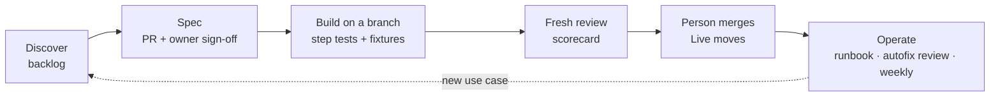

# 3B Agentic Starter Kit

**Onboard enterprise teams onto Tines 3B with an agentic build method that their security team will sign off on.**

Builders work in Cursor or Claude Code, connected to their 3B tenant over MCP. Their agents follow Tines' official skills for *how* to build, this kit's skills for *what* to build, *in what order*, and *how to prove it's done*, and a short set of rules that hooks enforce. Every change is a reviewed pull request; Live moves only when a person merges.

> Private repository. Every 3B claim carries a status label and a source; see [docs/02-availability.md](docs/02-availability.md).

## Who it's for

- **Customer builders and platform teams** adopting 3B who want AI to write the code without giving up review, testing or control.
- **Tines CSEs** running onboarding programmes: the same method, every engagement, with a record of what was decided and why.

## What's inside

| Path | What it is |
|---|---|
| [`AGENTS.md`](AGENTS.md) | The short rules every agent follows (Cursor and Claude Code both load it) |
| [`.claude/skills/`](.claude/skills) | Nine onboarding skills: `3b-onboard` (front door), `3b-readiness`, `3b-discover`, `3b-spec`, `3b-build-loop`, `3b-review`, `3b-mcp`, `3b-operate`, `3b-handover` |
| [`.claude/agents/`](.claude/agents) | Subagents: `onboarding-lead`, `solution-architect` (read-only), `builder`, `reviewer` (read-only, fresh context) |
| [`scripts/hooks/guard.py`](scripts/hooks/guard.py) | Deterministic guard for both editors: agents can't publish, delete, grant access, handle keys or change connectors |
| [`tenant-skills/enterprise-conventions/`](tenant-skills/enterprise-conventions/SKILL.md) | A conventions skill template, installed in editors **and** imported into 3B, so the rules are the same everywhere |
| [`kit/engagement-repo-template/`](kit/engagement-repo-template) | The customer's engagement repository: specs, fixtures, runbooks, onboarding records, CI |
| [`kit/templates/`](kit/templates) | Spec, profile, backlog, success plan, runbook and fixture templates |
| [`evals/`](evals) | Golden tasks per skill, plus the grading rubric |
| [`docs/00-visual-tour.md`](docs/00-visual-tour.md) | **Start here.** Twelve diagrams, one idea each: repositories, MCP directions, the programme, the build loop, the ship path, trust boundaries, the guard, quality layers |
| [`docs/`](docs/README.md) | What 3B is, availability, the agentic architecture, setup, MCP, the programme, governance, quality, decisions, the guide |
| [`demo/`](demo/README.md) | The 25-minute demo: a synthetic EDR alert-triage workflow from spec to Live, built twice (plain prompt vs the kit), with talk track, fixtures and fallbacks |
| [`prompts/`](prompts) | Prompts for Cursor and 3B to keep building this kit and its onboarding guide, plus the sync protocol |
| [`PLAN.md`](PLAN.md) | The roadmap from bootstrap to v1 |

## Quickstart (about 20 minutes)

1. **Connect your editor** to `https://<your-tenant>/mcp` with OAuth, using the Tines 3B Cursor plugin or the Claude Code snippet on the tenant's Settings → MCP page ([setup guide](docs/04-setup-cursor-and-claude-code.md)).
2. **Install Tines' official skills, pinned:** `scripts/bootstrap.sh skills`.
3. **Create an engagement repository:** `scripts/bootstrap.sh engagement ../acme-3b-engagement`, then clone the space repository into its `space/` folder.
4. **Open the engagement repository** in your editor and run **`/3b-onboard`**.

## How it works

Why it's built this way: [docs/03-agentic-architecture.md](docs/03-agentic-architecture.md) and the [decision records](docs/decisions/README.md). To see it before you read it: [the visual tour](docs/00-visual-tour.md). To show it to others: [the demo](demo/README.md).

## Contributing

Branch, pull request, CI (`python3 scripts/validate.py`), then a fresh-context review. Never push to `main`. See [prompts/03-sync-protocol.md](prompts/03-sync-protocol.md).
