# The visual tour

_Twelve diagrams, one idea each, in the order a new builder meets them. Every diagram links to the file that is the source of truth; where a diagram and its source disagree, the source wins and this page is the bug. 3B facts come from the public docs and Tines' official skills; anything unconfirmed is in [`VERIFY.md`](VERIFY.md)._

Time: 30 minutes. Audience: anyone new to the kit: customer builders, platform owners, security reviewers, CSEs, and the AI agents that will enhance it.

---

## 1. Three repositories, three jobs

The kit is the reusable layer. Each customer gets an **engagement repository** (specs, fixtures, runbooks, onboarding records, agent configuration) with their **space repository** cloned inside it. The space repository is Git-synced to the 3B space and holds workflows only, because 3B treats every top-level folder there as a workflow and rejects executables, symlinks and submodules.

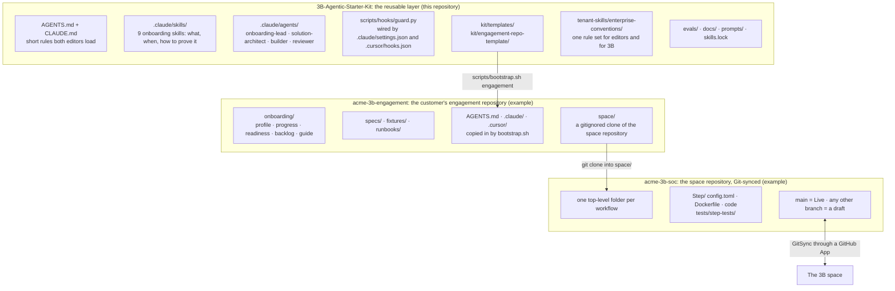

**Read next:** [`README.md`](../README.md), [`decisions/0004-git-is-source-of-truth.md`](decisions/0004-git-is-source-of-truth.md), [`../kit/engagement-repo-template/README.md`](../kit/engagement-repo-template/README.md).

---

## 2. MCP meets 3B in three directions

The kit uses all three. Direction A is how builders work from day one. Direction B is phase 4, read-only tools first. Direction C is how an agent in a workflow reaches a vendor's tools without ever holding a credential.

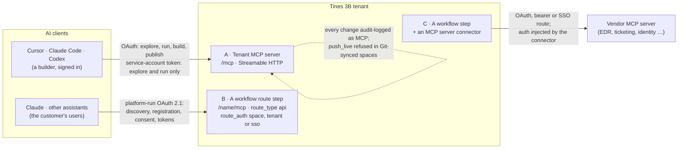

**Read next:** [`05-mcp-with-3b.md`](05-mcp-with-3b.md), [`decisions/0011-mcp-direction-policy.md`](decisions/0011-mcp-direction-policy.md), [`../.claude/skills/3b-mcp/SKILL.md`](../.claude/skills/3b-mcp/SKILL.md).

---

## 3. The onboarding programme: six phases, each with an exit a person signs

`3b-onboard` walks the phases in order and stops at the first one whose exit criteria aren't all met. Nothing skips phase 0: every later phase depends on access, GitSync, connectors and the recorded MCP tool list.

```mermaid
flowchart LR
    P0["0 · Readiness<br/>access · GitSync · MCP over OAuth<br/>connectors · AI provider"]
    P1["1 · Discover<br/>ranked backlog → signed-off spec"]
    P2["2 · First workflow<br/>deterministic · step tests · Live"]
    P3["3 · Agentic<br/>AI only where judgment is needed"]
    P4["4 · MCP<br/>editors on MCP · tools served safely"]
    P5["5 · Operate and scale<br/>weekly review · conventions · handover"]
    P0 -->|"tools/list recorded,<br/>first connectors tested"| P1
    P1 -->|"owner approves the spec PR"| P2
    P2 -->|"PR merged, step tests<br/>green at push-live"| P3
    P3 -->|"eval set scored,<br/>approvals in place"| P4
    P4 -->|"tool list approved"| P5
    P5 -.->|"next use case"| P1
```

| Phase | Kit skills | Typical length |
|---|---|---|
| 0 | `3b-readiness` | week 1 |
| 1 | `3b-discover`, `3b-spec` | weeks 1–2 |
| 2 | `3b-build-loop`, `3b-review`, `3b-operate` | weeks 2–3 |
| 3 | `3b-spec`, `3b-build-loop`, `3b-review` | weeks 4–6 |
| 4 | `3b-mcp` | weeks 5–8 |
| 5 | `3b-operate`, `3b-handover` | weeks 8–12 |

**Read next:** [`06-onboarding-programme.md`](06-onboarding-programme.md), [`../.claude/skills/3b-onboard/references/programme.md`](../.claude/skills/3b-onboard/references/programme.md).

---

## 4. The build loop: one workflow, from a spec to a pull request

A person asks. The builder, the only subagent that writes to `space/`, shows a plan, waits for a yes, builds on a branch using Tines' `building-workflows` skill, tests, and opens a pull request. The guard hook runs whether or not the model agrees.

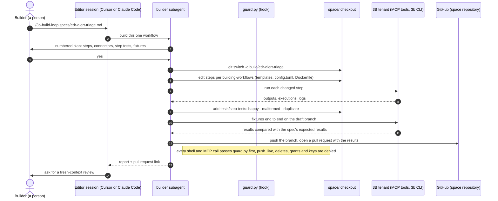

**Read next:** [`../.claude/skills/3b-build-loop/SKILL.md`](../.claude/skills/3b-build-loop/SKILL.md), [`../.claude/agents/builder.md`](../.claude/agents/builder.md), [`decisions/0008-git-to-build-mcp-for-context-cli-to-run.md`](decisions/0008-git-to-build-mcp-for-context-cli-to-run.md).

---

## 5. The ship path: from pull request to Live

Live moves only when a person merges to `main`. 3B then runs the step tests at push-live, and a failing test blocks the release. Autofix and autotune proposals come back as branches and go through the same review.

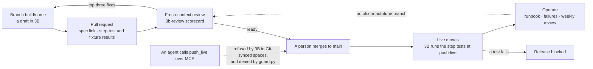

**Read next:** [`decisions/0007-people-approve-the-irreversible.md`](decisions/0007-people-approve-the-irreversible.md), [`decisions/0009-step-tests-and-evals-are-acceptance.md`](decisions/0009-step-tests-and-evals-are-acceptance.md), [`../.claude/skills/3b-operate/SKILL.md`](../.claude/skills/3b-operate/SKILL.md).

---

## 6. Skills: what stays resident, what loads on demand

Progressive disclosure keeps the context small. `AGENTS.md` is always loaded and stays under 200 lines. Every procedure is a skill, about 100 tokens each until it's used. Tines' official skills teach *how* to build in 3B; the kit's teach *what*, *when* and *how to prove it*; the conventions skill carries the customer's own rules into the editor and into 3B.

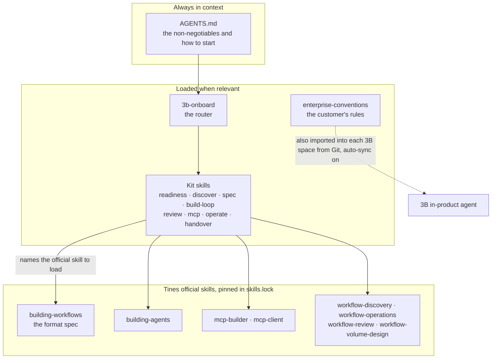

**Read next:** [`decisions/0001-compose-official-skills.md`](decisions/0001-compose-official-skills.md), [`decisions/0002-skills-over-one-big-prompt.md`](decisions/0002-skills-over-one-big-prompt.md), [`decisions/0012-same-skills-in-editor-and-product.md`](decisions/0012-same-skills-in-editor-and-product.md).

---

## 7. Who may do what: trust boundaries

Two subagents read, one writes on a branch after a yes, and a short list of actions belongs to people only. The guard hook enforces the last row; it doesn't rely on the model remembering.

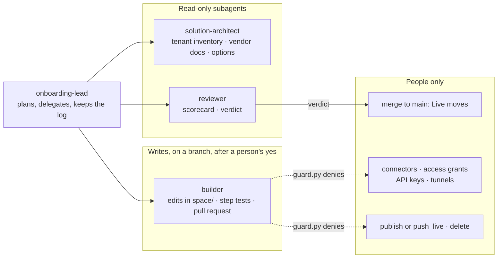

**Read next:** [`../.claude/agents/`](../.claude/agents/), [`decisions/0005-one-orchestrator-few-subagents.md`](decisions/0005-one-orchestrator-few-subagents.md), [`decisions/0006-fresh-context-review.md`](decisions/0006-fresh-context-review.md).

---

## 8. The guard hook, decision by decision

One script, two editors. Claude Code calls it as a `PreToolUse` hook on Bash and every MCP tool; Cursor calls it before shell and MCP execution, fail-closed for MCP. Until the 3B MCP tool list is published, MCP tools are matched by name pattern.

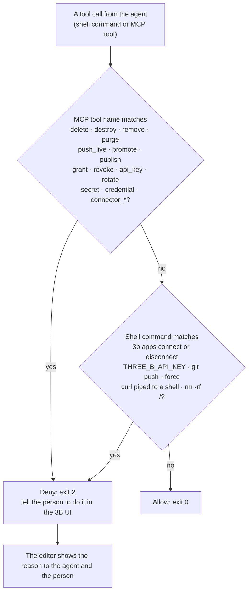

**Read next:** [`../scripts/hooks/guard.py`](../scripts/hooks/guard.py), [`../.claude/settings.json`](../.claude/settings.json), [`../.cursor/hooks.json`](../.cursor/hooks.json), [`VERIFY.md`](VERIFY.md) items V1 and V7.

---

## 9. Quality: five layers, graded by code first

"It looks right" is how AI-built work fails. Each layer catches a different class of mistake, and the first two are native to 3B.

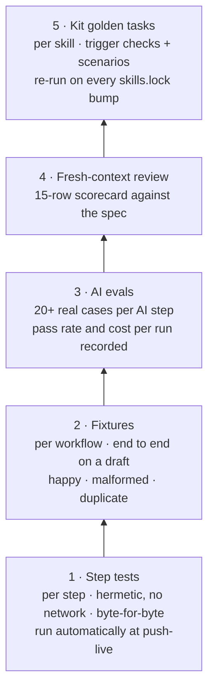

**Read next:** [`08-quality-and-evals.md`](08-quality-and-evals.md), [`../.claude/skills/3b-review/references/scorecard.md`](../.claude/skills/3b-review/references/scorecard.md), [`../evals/README.md`](../evals/README.md).

---

## 10. AI inside a workflow: the model reasons, a person approves, the workflow executes

When a use case needs judgment, the AI step recommends from an allow-list and emits strict JSON. A deterministic step validates it, a person approves anything consequential, and only an approved request triggers the side effect.

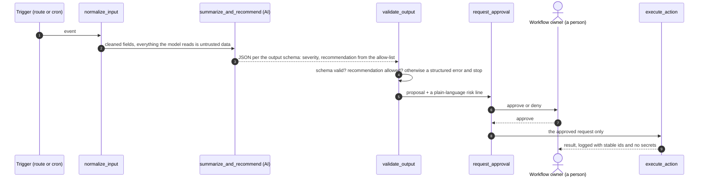

**Read next:** [`03-agentic-architecture.md`](03-agentic-architecture.md) §3, [`decisions/0003-deterministic-first.md`](decisions/0003-deterministic-first.md), the spec template §5–6 in [`../kit/templates/workflow-spec.md`](../kit/templates/workflow-spec.md).

---

## 11. A change's journey across the two repositories

The spec lands in the engagement repository and the owner approves it there. The build lands in the space repository and a person merges it there. Fixtures cross over at test time; the runbook is written after Live.

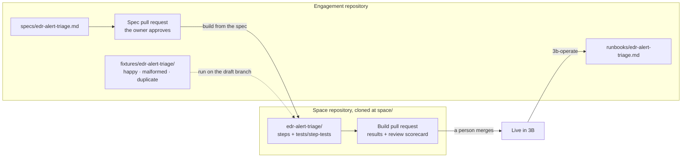

**Read next:** [`decisions/0004-git-is-source-of-truth.md`](decisions/0004-git-is-source-of-truth.md), [`../.claude/skills/3b-spec/SKILL.md`](../.claude/skills/3b-spec/SKILL.md).

---

## 12. Day one: from nothing to `/3b-onboard`

What a platform owner and a CSE do before the first build session. Every step that touches a credential is done by a person; the kit never sees a key.

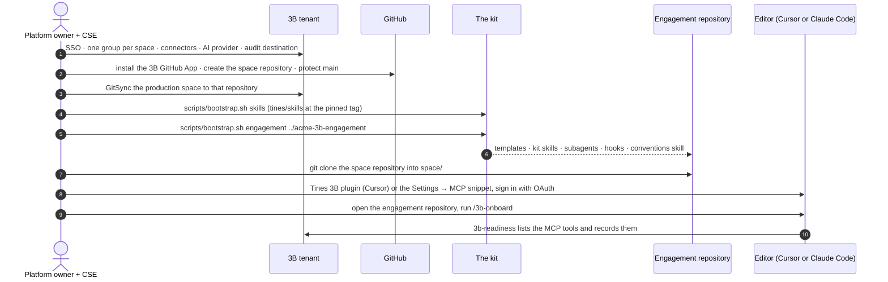

**Read next:** [`04-setup-cursor-and-claude-code.md`](04-setup-cursor-and-claude-code.md), [`../scripts/bootstrap.sh`](../scripts/bootstrap.sh), [`../.claude/skills/3b-readiness/SKILL.md`](../.claude/skills/3b-readiness/SKILL.md).

---

## Check yourself

1. Where does a workflow's code live, and why can't the spec live next to it? *(Diagram 1, 11)*
2. Which credential can call the 3B MCP build and publish tools, and what can a service-account token do? *(Diagram 2)*
3. Why does the programme never skip phase 0? *(Diagram 3)*
4. Name the only subagent that writes to `space/`, and the two things it can never do. *(Diagrams 4, 7)*
5. What happens when an agent calls `push_live` in a Git-synced space? Name both controls. *(Diagrams 5, 8)*
6. Which layer catches a changed expected output that nobody confirmed? *(Diagram 9)*
7. In an AI step, what sits between the model's recommendation and the side effect? *(Diagram 10)*
8. Which steps on day one involve a credential, and who performs them? *(Diagram 12)*
