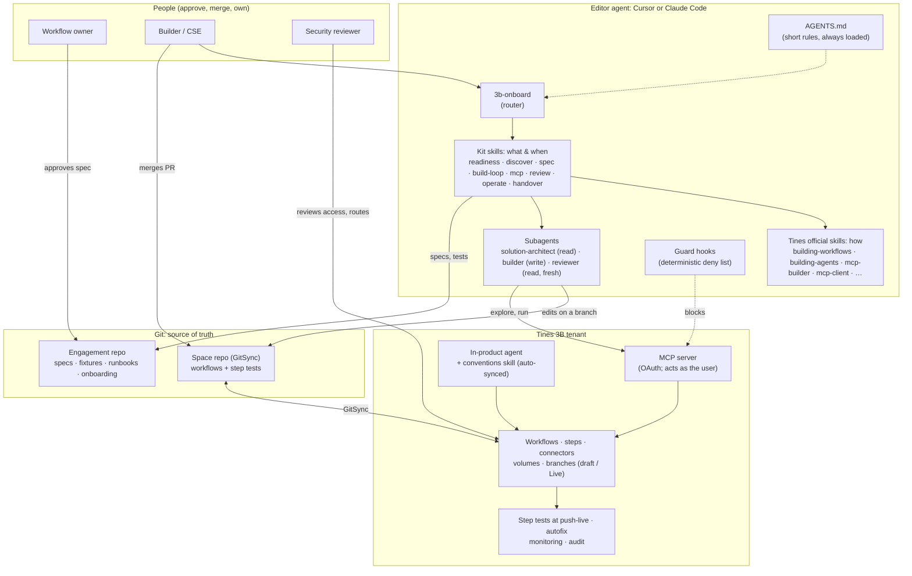

# The agentic architecture of this kit

This page explains the concepts the kit is built on, why each one is there, and where it lives in the repository. Each decision links to an ADR in `docs/decisions/`. For the same ideas as pictures, one per diagram, read [the visual tour](00-visual-tour.md) first.

## 1. The system on one page

## 2. Concepts, decisions and where they live

| Concept (source) | What the kit does | Why | Where |
|---|---|---|---|
| **Workflows vs agents**: use the simplest pattern that works ([Building effective agents](https://www.anthropic.com/engineering/building-effective-agents)) | Every use case gets an `agentic_fit`. Deterministic first, then one AI step, then a workflow of AI steps; an agent only when steps can't be predicted | Agents trade cost and latency for flexibility; most enterprise automation is predictable | ADR 0003; `3b-discover`; spec template |
| **Prompt chaining with gates** | The build loop is a gated chain: spec → plan → approval → build → step tests → fixtures → PR → review → merge | Each gate is a check you can run, so errors stop early | `3b-build-loop` |
| **Routing** | One front door (`3b-onboard`) loads exactly one specialist skill for the phase | Specialists beat a do-everything prompt; descriptions drive selection | `3b-onboard` |
| **Evaluator–optimizer** | A fresh-context reviewer scores every PR against the spec; the builder fixes; the reviewer re-checks | A builder is biased toward its own work; clear criteria make the loop converge | ADR 0006; `reviewer`; `3b-review` |
| **Orchestrator–workers / multi-agent** | Deliberately limited: one working session plus read-only subagents | Multi-agent runs cost about 15× chat tokens and suit parallel, independent work, which building rarely is ([multi-agent research](https://www.anthropic.com/engineering/multi-agent-research-system)) | ADR 0005; `.claude/agents/` |
| **Context engineering and progressive disclosure** ([context engineering](https://www.anthropic.com/engineering/effective-context-engineering-for-ai-agents), [Agent Skills spec](https://agentskills.io/specification)) | Short `AGENTS.md`; procedures as skills of under 500 lines with `references/` one level deep; subagents return condensed summaries | Context is a finite attention budget, and only about 100 tokens per skill stay resident | ADR 0002 |
| **Reuse the source of product truth** | Tines' official skills, pinned; kit skills never re-teach the platform | Less to maintain and no drift; pinned supply chain | ADR 0001; `skills.lock` |
| **Tool design** ([Writing tools for agents](https://www.anthropic.com/engineering/writing-tools-for-agents), [MCP tools spec](https://modelcontextprotocol.io/specification/latest/server/tools)) | Few, workflow-shaped tools; read/write split; structured errors; small results; handle plus status for long work | Selection quality falls as tools multiply; errors must be actionable | `3b-mcp` + `references/tool-design.md` |
| **Right interface per job** | Git to change, MCP for tenant context and actions, CLI to run and inspect | Reviewable diffs; cheapest reliable output | ADR 0008 |
| **Human in the loop** ([MCP spec](https://modelcontextprotocol.io/specification/latest/server/tools)) | Reads run freely. Writes need an approved plan. Merging to `main`, deletes, access, keys and connector changes are done or approved by people, enforced by 3B RBAC and GitHub branch protection | Approval fatigue erodes review, so gate few things, clearly | ADR 0007 |
| **Guardrails as code, as defence in depth** ([Claude Code hooks](https://code.claude.com/docs/en/hooks-guide), [Cursor hooks](https://cursor.com/docs/hooks)) | `scripts/hooks/guard.py` denies publish-shaped MCP tools, pushes to `main`, merges, deletes, grants, keys, connector changes, force pushes, installer pipes and ad-hoc skill installs, in both editors | Prose is advisory and hooks are deterministic, but hooks live in files the builder owns, so they catch mistakes early rather than being the control | ADR 0007 |
| **Subagents behave differently per editor** | `readonly: true` (Cursor: blocks file writes) and `disallowedTools` (Claude Code: blocks edit tools) on the read-only subagents; the `tools` allowlist is not used so MCP read tools are inherited | One file, two dialects; the prose contract is the same in both | ADR 0005; `VERIFY.md` V14 |
| **Evals before docs** ([Demystifying evals](https://www.anthropic.com/engineering/demystifying-evals-for-ai-agents)) | Step tests per step; fixtures per workflow; 20+ case evals per AI step; golden tasks per kit skill | Outcomes, graded by code first, catch what looks right but isn't | ADR 0009; `evals/` |
| **Least agency and no token passthrough** ([MCP security](https://modelcontextprotocol.io/specification/latest/basic/security_best_practices), [OWASP LLM Top 10 2026](https://genai.owasp.org/resource/owasp-genai-llm-top-10-2026/)) | OAuth as the user; service accounts limited to read and run; connectors inject credentials; read-only MCP tools first | Excessive agency and confused-deputy risks | ADR 0011 |
| **One set of conventions everywhere** | The customer's conventions skill is installed in editors and imported into 3B with auto-sync | Same rules wherever building happens | ADR 0012; `tenant-skills/` |
| **Untrusted input** ([OWASP Agentic Top 10](https://genai.owasp.org/resource/owasp-top-10-for-agentic-applications-for-2026/)) | Every skill treats tool, web and model output as data, and quotes injected instructions to the person | Indirect prompt injection is the top risk | `AGENTS.md` rule; build-loop golden task 03 |
| **Honest maturity** | Status labels on every 3B claim; a VERIFY register | Skills that teach unconfirmed features break trust | ADR 0010; `docs/02-availability.md`, `docs/VERIFY.md` |

## 3. Inside the customer's runtime: AI in 3B workflows

When a use case does need AI, the kit steers it toward the shapes in Tines' `building-agents` skill:

| Shape | Use when | Guardrails the kit requires |
|---|---|---|
| **Single request** (one model call, no tools) | Classify, extract, summarize, rewrite | Strict output schema validated downstream; token budget |
| **Interactive agent** (route + output, streams) | A person converses with it | Per-user conversations; allowed tools only; no irreversible tool without approval |
| **Async agent** (self-links, no route) | Background investigation that can't be scripted | Iteration and token budget; downstream acts only on a terminal status; consequential actions wait for a person |

The pattern that works for consequential actions: **the AI reasons, a person approves, the workflow executes.** The model recommends from an allow-list, a step posts the approval request, and only an approved request triggers the side effect.

## 4. What we deliberately don't do

- No autonomous publishing. Live moves only when a person merges.
- No multi-agent swarm in v1.
- No generic "call any API" tool for agents.
- No secrets in prompts, skills, repositories or volumes.
- No features presented before they're verified.
