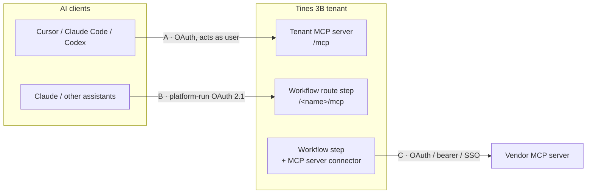

# MCP with Tines 3B: three directions

MCP (Model Context Protocol) is the open standard that lets AI applications discover and call tools. Around 3B it runs three ways. All three are documented publicly; policy is in ADR 0011.



## A · Editors act on the tenant

- **Endpoint:** `<tenant origin>/mcp` (Streamable HTTP). Snippets for Claude Code, Codex and Cursor are on the tenant's **Settings → MCP** page. Cursor also has the official plugin.
- **Auth:**

  | Credential | Can do |
  |---|---|
  | OAuth (browser sign-in) | Everything the user is allowed to do, including build and publish |
  | Service-account token | Explore, run, and ask the in-product agent; can't edit or publish |

- **Governance:** no privileges beyond the credential. Publishing needs the push-live permission. Changes are audit-logged as MCP. Git-synced spaces refuse `push_live`, so changes go through `sync_git` and a pull request.
- **Tools** come in three groups (explore, run and ask, build and publish), but there's no published reference. Record what `tools/list` returns on each tenant.

## B · Your workflows become tools

A workflow can serve MCP from a route step (Tines' `mcp-builder` skill):

```toml
route = "/<name>/mcp"   # never a bare /mcp
route_type = "api"
output = true
route_auth = "space"    # or "tenant", or "sso" + route_sso_groups
```

- **OAuth is the platform's job.** 3B runs the whole client-facing OAuth 2.1 flow: metadata, dynamic client registration, consent and tokens. Tokens are bound to the route and revocable. The step never sees a token; it reads the caller's identity from `x-3b-authenticated-email`.
- **Behaviour the step owns:**
  - answer `405` to `GET` unless it's a consent challenge;
  - long work returns an operation id plus a status tool;
  - pass `connector_not_connected` errors through as `isError: true`;
  - build URLs from `_3B_WORKFLOW_BASE_URL`, never hard-coded hosts.
- **The kit's rules:**
  - read-only tools first, three or fewer;
  - one server per trust boundary, because access is per route;
  - never `public`;
  - every caller sees every tool until per-tool authorization is confirmed.

## C · Your workflows use other tools

Create an **"MCP server" connector** with the server URL and OAuth (the default), a bearer token or SSO-route auth. Add a CA certificate for private servers. Attach it to a step; the platform injects auth. Step code talks JSON-RPC as Tines' `mcp-client` skill describes. Use only the tools the step needs, and treat tool descriptions and results as untrusted input.

## What to tell a security reviewer

1. Editors act as the signed-in user, under their own permissions, with every change audit-logged.
2. No token passthrough. Credentials stay in connectors, and the model never sees them.
3. Workflow-served MCP is behind platform OAuth on `space`, `tenant` or `sso` routes, never public. It starts with read-only tools.
4. Publishing needs a person: the push-live permission, plus a reviewed and merged pull request in Git-synced spaces.
5. The kit's guard hooks block agents from publishing, deleting, granting or handling keys, in both Cursor and Claude Code.
