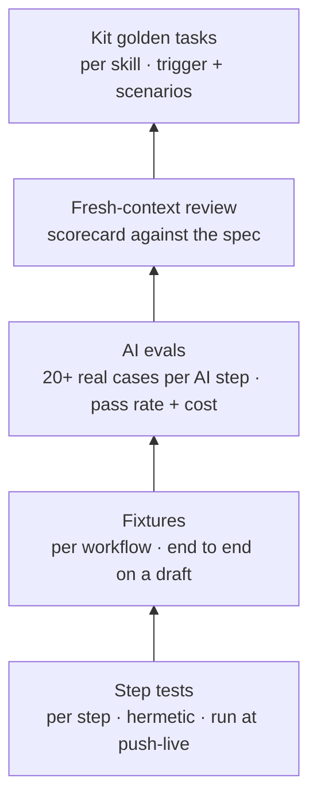

# Quality: the test layers

| Layer | Who writes it | When it runs | Passes when |
|---|---|---|---|
| **Step tests** (`<Step>/tests/step-tests/`) | Builder agent, during the build | Before the PR, and automatically at push-live | Byte-for-byte match; expected outputs change only with the owner's confirmation |
| **Fixtures** (`fixtures/<workflow>/`) | `3b-spec` | On the draft branch before the PR (ask first if there are side effects) | Results match the spec's expected results |
| **AI evals** | Builder plus the workflow owner | Before an AI step goes live, and after any prompt or model change | Pass rate at or above the target in the spec; cost per run recorded |
| **Review** (`3b-review`) | Reviewer subagent, in a fresh context | Every PR | Verdict "ready"; top fixes addressed |
| **Golden tasks** (`evals/golden-tasks/`) | Kit maintainers | On any skill change or `skills.lock` bump | Trigger checks right; scenarios pass on Outcome and Safety |

## Grading rules

- **Grade the outcome, not the path.** Did the right thing happen and nothing unsafe happen?
- **Code first.** If a check can be a script (file exists, test passes, JSON validates), make it one.
- **LLM judges only for fuzzy criteria:** one dimension per judge, a rubric, an "Unknown" option, and a different model from the one being graded. Calibrate against a person's grades.
- **Keep capability and regression sets separate.** Regressions block merges; capability sets show where to improve.
- **Read transcripts.** Numbers say that something failed; transcripts say why.

Source: [Demystifying evals for AI agents](https://www.anthropic.com/engineering/demystifying-evals-for-ai-agents).
